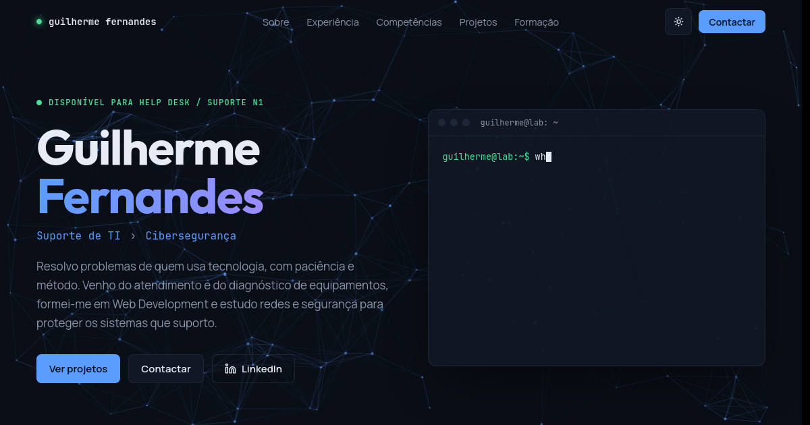

# Portfólio · Guilherme Fernandes

Site pessoal de **Guilherme Fernandes**, técnico de suporte informático em Santa Maria da Feira (Porto).
Procuro a primeira função em **Help Desk / Suporte N1**, com direção para **cibersegurança**.

**Ver online:** https://kinnek0x.github.io



## O que tem

- Apresentação, experiência, competências, projetos, formação e contacto, numa só página.
- Terminal animado no topo e campo de partículas que reage ao rato.
- Tema claro e escuro.
- Funciona bem no telemóvel e respeita a opção "reduzir movimento" do sistema.

## Tecnologias

HTML, CSS e JavaScript puros. Sem frameworks, sem passo de build, sem dependências.
Alojado no GitHub Pages.

## Decisões de segurança e privacidade

| O quê | Como |
|---|---|
| Content-Security-Policy | `<meta>` no HTML (o GitHub Pages não permite cabeçalhos): só ficheiros do próprio site |
| Sem código inline | Nenhum `<script>` ou `style=` inline, por isso a CSP não precisa de `'unsafe-inline'` |
| XSS | Texto dos ficheiros de dados é sempre escapado antes de entrar na página |
| Privacidade dos visitantes | Fontes e ícones locais (nada é pedido à Google), sem analytics e sem cookies |
| Dados pessoais | Testes automáticos falham se o telefone ou o e-mail pessoal aparecerem num ficheiro público |
| Foto | Sem metadados EXIF (podem revelar aparelho, data e localização) |
| Commits | Feitos com o e-mail `noreply` do GitHub |

## Correr localmente

```bash
python3 -m http.server 8000
```

Depois abrir http://localhost:8000.

Testes (precisa de Node.js, sem instalar nada):

```bash
npm test
```

## Acrescentar uma competência ou um projeto

Não é preciso mexer no HTML:

- Competências: `data/competencias.json`
- Projetos: `data/projetos.json`

Cada ficheiro tem um campo `_ajuda` a explicar o formato. Corra `npm test` antes de publicar: o teste avisa se faltar algum campo.

## Créditos

- Fontes: [Outfit](https://fonts.google.com/specimen/Outfit), [Manrope](https://fonts.google.com/specimen/Manrope) e [JetBrains Mono](https://www.jetbrains.com/lp/mono/) (SIL Open Font License)
- Ícones: [Devicon](https://devicon.dev) (MIT), [Simple Icons](https://simpleicons.org) (CC0) e [Lucide](https://lucide.dev) (ISC)
